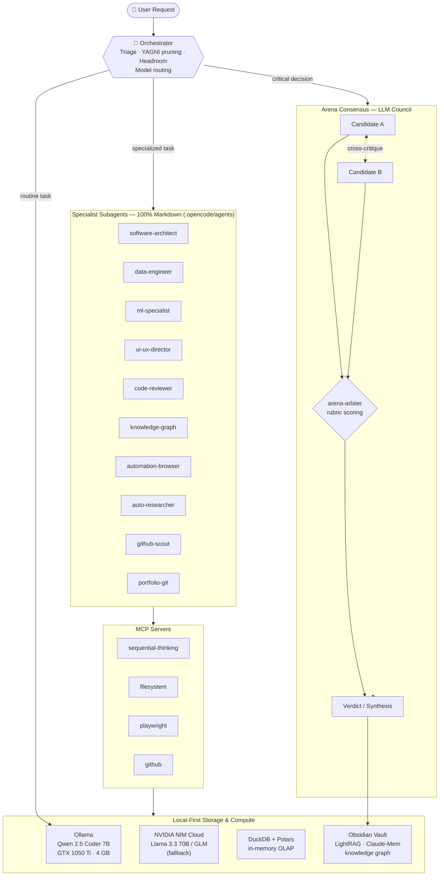

<div align="center">

# AI Nexus Core — Autonomous, Local-First Multi-Agent Ecosystem

**A decoupled agentic architecture governed by multi-model consensus, running entirely on local hardware at zero inference cost.**

[](https://www.python.org/)
[](https://duckdb.org/)
[](https://pola.rs/)
[](https://playwright.dev/)
[](https://ollama.com/)
[](https://build.nvidia.com/)
[](https://opencode.ai/)
[](https://www.microsoft.com/windows/)
[](LICENSE)


*10-second motion showcase — [interactive HTML scene](assets/motion_showcase.html) · [raw WebM](assets/video/showcase_ai_nexus_core.webm)*

</div>

---

## Architectural Pillars

### 1. Local-First & Cost Optimization
A hybrid inference engine keeps every routine task on-premise: **Ollama** serves **Qwen 2.5 Coder 7B** on consumer-grade hardware (NVIDIA GTX 1050 Ti, 4 GB VRAM) with zero API spend. When quality or context demands exceed the local model, the orchestrator proposes an escalation path to **NVIDIA NIM cloud APIs** (Llama 3.3 70B / GLM) — the user decides, never the framework.

### 2. 100% Markdown-Native Agents
Agents are not code. They are plain `.md` files implementing the **Linux Foundation `AGENTS.md` standard** and the **Anthropic Agent Skills specification**. No `class Agent`, no CrewAI, no LangChain, no monolithic orchestration frameworks — every agent is a readable, versionable, portable document with its own mandatory tool-and-skill matrix. Zero lock-in.

### 3. Arena Consensus (LLM Council)
Small local models hallucinate; consensus fixes that. Every critical decision — architecture, security, destructive operations, ML design — enters a **tournament protocol**: 2–3 candidate solutions are generated in parallel by independent subagents, cross-critiqued, then scored by an arbiter against a four-axis rubric (simplicity, speed, security, robustness). A security score ≤ 2 disqualifies a variant outright. The verdict is persisted to long-term memory.

### 4. Anti-Slop Motion Design Suite
UI work is governed by a strict design system: token-first styling, modular type scales (Impeccable), visual criteria (Taste) and **spring physics under 300 ms** (Emil Kowalski). Generic template aesthetics — default purple gradients, cloned shadow cards, emoji icons — are banned by lint-level rules. Every interface is validated in a real browser with **Playwright**.

### 5. High-Performance OLAP Data Engine
**DuckDB + Polars** process CSV, Parquet and JSON in streaming, in-memory fashion — 100,000-record pipelines run without ever exceeding a 500 MB RAM ceiling on the local workstation. No servers, no clusters, no infrastructure.

### 6. Knowledge Graph & Obsidian Vault
The repository doubles as an **Obsidian vault**: decisions, entities and session logs persist as interlinked Markdown (`[[wikilinks]]`) and are indexed into an entity-relation + vector knowledge graph via **LightRAG** and **Claude-Mem**, with structural code mapping by **Graphify**. Memory survives sessions; context never starts from zero.

---

## System Architecture



---

## The 12 Multi-Agent Squad

Every agent is a single Markdown file with a mandatory tool matrix — it can only use what its matrix declares. All agents share the core skills `find-skills` (Vercel Labs open registry lookup before building anything new) and `headroom-context` (token budget compression).

| Agent | Role | Specialty | Linked Skills |
|---|---|---|---|
| `orchestrator` | Master router | Request triage, YAGNI scope pruning, context compression, model routing | `ponytail-yagni`, `arena-consensus`, `sequential-thinking` |
| `software-architect` | Architect | Clean architecture, SOLID, minimalist design via the YAGNI ladder | `ponytail-yagni`, `graphify-codebase`, `arena-consensus` |
| `data-engineer` | Data engineer | High-speed OLAP pipelines over local CSV / Parquet | `duckdb-analytics`, `sequential-thinking` |
| `ml-deeplearning-specialist` | ML engineer | PyTorch, Hugging Face MCP, VRAM/CUDA optimization, local embeddings | `neural-network-ml`, `sequential-thinking`, `auto-research` |
| `ui-ux-director` | Design director | Anti-slop UI, design tokens, spring-physics micro-animations | `ui-ux-design-suite`, `playwright-testing` |
| `code-reviewer-security` | Security auditor | Static analysis, OWASP Top 10, credential-leak detection | `ponytail-yagni`, `graphify-codebase`, `auto-research` |
| `arena-arbiter` | Tournament judge | Cross-critique moderation, rubric scoring, final verdict synthesis | `arena-consensus` |
| `knowledge-graph-agent` | Context guardian | LightRAG, Claude-Mem, Graphify, Obsidian graph synchronization | `lightrag-knowledge`, `graphify-codebase` |
| `automation-browser` | Browser automation | Playwright E2E, Crawl4AI scraping, n8n workflows | `playwright-testing`, `auto-research` |
| `auto-researcher` | Researcher | Official-docs validation, dependency & compatibility checks | `auto-research` |
| `github-scout` | Trends sentinel | Viral AI repository detection, Windows Toast alerts | `windows-notifier`, `auto-research` |
| `portfolio-git` | Portfolio manager | Semantic commits, GitHub portfolio synchronization | `git-portfolio-sync`, `ponytail-yagni` |

---

## Setup & Execution Guide

### Prerequisites

| Requirement | Purpose |
|---|---|
| **Python 3.12+** | Utility scripts (`scripts/`) and data tooling |
| **Node.js 18+** | OpenCode runtime and `npx skills` registry lookups |
| **Ollama** | Local inference — pull the default model: `ollama pull qwen2.5-coder:7b` |
| **NVIDIA NIM API key** *(optional)* | Cloud fallback for tasks exceeding local model capacity |
| **Git + GitHub account** | Portfolio synchronization via `portfolio-git` |

### Installation

```bash
# 1 · Clone the repository
git clone https://github.com/AFelipeRD/AI_Nexus_Core.git
cd AI_Nexus_Core

# 2 · Create and activate a virtual environment
python -m venv .venv
.venv\Scripts\activate        # Windows
# source .venv/bin/activate   # Linux / macOS

# 3 · Install dependencies
pip install -r requirements.txt

# 4 · Install the Playwright browser (for E2E testing & video recording)
playwright install chromium
```

> **GPU note (Windows):** for CUDA-enabled PyTorch, install it *before* the requirements:
> `pip install torch torchvision --index-url https://download.pytorch.org/whl/cu124`

### Environment Configuration

```bash
cp .env.example .env    # Windows: copy .env.example .env
```

Fill in your own keys — `GITHUB_PERSONAL_ACCESS_TOKEN`, `NVIDIA_API_KEY`, `HF_TOKEN`. The `.env` file is git-ignored and **must never** reach the repository.

### Usage with OpenCode

```bash
npm install -g opencode-ai    # or: curl -fsSL https://opencode.ai/install | bash
opencode                      # run from the repository root — agents, skills and
                              # commands are discovered automatically from .opencode/
```

### Slash Commands

| Command | Purpose |
|---|---|
| `/arena` | Critical-decision tournament: parallel candidates, cross-critique, rubric verdict |
| `/craft` | UI/UX build with design tokens and spring-physics motion |
| `/analyze-data` | DuckDB + Polars OLAP session over local CSV / Parquet / JSON |
| `/browser-test` | Playwright E2E validation in a real browser |
| `/scout` | GitHub trending scan with native Windows Toast alerts |
| `/commit` | Semantic commit packaging and portfolio sync |

*Plus 11 more: `/think`, `/yagni`, `/headroom`, `/research`, `/critique`, `/taste`, `/animate`, `/graphify`, `/train-model`, `/security-audit`, `/sync-catalog` — see [`.opencode/commands/`](.opencode/commands/README.md).*

---

## License & Author

Released under the **[MIT License](LICENSE)**.

**AFelipeRD** — AI Engineer · [GitHub](https://github.com/AFelipeRD) · [afrsenju@outlook.com](mailto:afrsenju@outlook.com)

> Built on Windows 11 with local models, zero inference cost, and a firm belief that agents should be documents — not frameworks.
