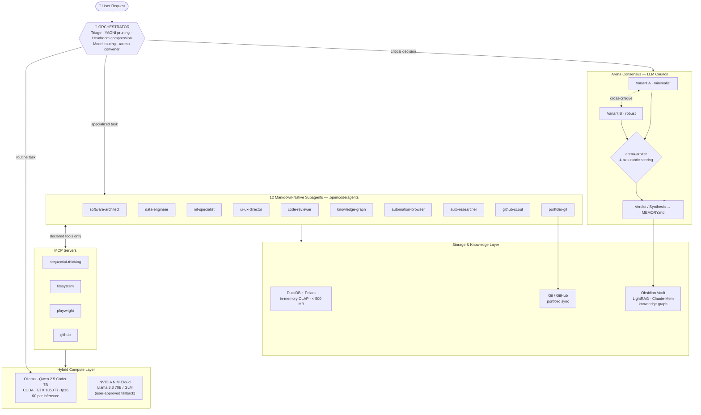

<div align="center">

# AI Nexus Core — Autonomous, Local-First Multi-Agent Ecosystem

**A decoupled, self-healing, multi-model intelligence architecture combining local hardware acceleration, arena consensus, and high-performance data engineering.**

[](https://www.python.org/)
[](https://duckdb.org/)
[](https://pola.rs/)
[](https://playwright.dev/)
[](https://ollama.com/)
[](https://build.nvidia.com/)
[](https://developer.nvidia.com/cuda-toolkit)
[](https://opencode.ai/)
[](https://www.microsoft.com/windows/)
[](LICENSE)


**▶ Try the live interactive artifact: [`opus_neural_interactive.html`](assets/opus_neural_interactive.html)** — a 45-node particle-physics neural network with magnetic cursor gravity, click-triggered shockwaves, a glassmorphic telemetry panel (live 60 FPS monitor, DuckDB + Polars streaming widget, GTX 1050 Ti status) and three GPU-composited render modes: *Quantum Physics*, *Neural Network*, *Data Mesh*.

*Above: the 10-second motion showcase — [HTML scene](assets/motion_showcase.html) · [raw WebM](assets/video/showcase_ai_nexus_core.webm)*

</div>

---

## Core Architectural Pillars

### 1. Hybrid Local/Cloud Compute
Every routine task runs on-premise at **zero inference cost**: Ollama serves **Qwen 2.5 Coder 7B** on an NVIDIA GTX 1050 Ti with **CUDA acceleration, fp16 mixed precision and explicit VRAM cache management** — engineered to operate fluently within 4 GB. When quality or context demands exceed the local model, the orchestrator proposes escalation to **NVIDIA NIM Cloud APIs** (Llama 3.3 70B / GLM). The user decides — never the framework.

### 2. 100% Markdown-Native Agents
Agents are not code. They are plain `.md` files implementing the **Linux Foundation `AGENTS.md` standard** and the **Anthropic Agent Skills specification** — zero `class Agent`, zero CrewAI, zero LangChain, zero monolithic frameworks. Every agent is a readable, versionable document with a mandatory tool-and-skill matrix: an agent can only use what its matrix declares. Zero lock-in, total portability.

### 3. Arena Consensus (LLM Council)
Small local models hallucinate; consensus fixes that. Critical decisions — architecture, security, destructive operations, ML design — enter a **tournament protocol**: subagents generate candidate variants from disparate approaches (minimalist, robust, ultra-fast), cross-critique each other's flaws, and an impartial arbiter scores them against a four-axis rubric (simplicity, speed, security, robustness). A security score ≤ 2 disqualifies a variant outright. Verdicts are persisted to long-term memory.

### 4. High-Speed OLAP Data Core
**DuckDB + Polars** process CSV, Parquet and JSON in streaming, in-memory fashion — 100,000-record pipelines run under a **strict 500 MB RAM ceiling** on the local workstation. No servers, no clusters, no infrastructure.

### 5. Anti-Slop Motion Engine (Opus-Level)
Interactive interfaces are governed by an engineering-grade design system: deep OLED palettes (`#020617` / `#030712`), diffuse radial gradient meshes, real glassmorphism (`backdrop-blur-xl` + `border-white/10`), spring physics under 250 ms with `cubic-bezier(0.16, 1, 0.3, 1)`, GPU-composited canvas layers (`will-change: transform`) targeting stable 60 FPS — all validated visually with **Playwright E2E** in a real browser.

### 6. Knowledge Graph & Obsidian Vault
The repository doubles as an **Obsidian vault**: decisions, entities and session logs persist as interlinked Markdown (`[[wikilinks]]`) and are indexed into an entity-relation + vector knowledge graph via **LightRAG** and **Claude-Mem**, with structural code mapping by **Graphify**. Memory survives sessions; context never starts from zero.

---

## System Architecture



---

## The 12 Multi-Agent Squad Matrix

Every agent is a single Markdown file with a mandatory tool matrix. All agents share the core skills `find-skills` (open-registry lookup before building anything new) and `headroom-context` (token budget compression).

| Agent | Role | Specialty | Mode | Mandatory Skills |
|---|---|---|---|---|
| `orchestrator` | Master router | Request triage, YAGNI scope pruning, context compression, model routing | Always-on · entry point | `ponytail-yagni`, `arena-consensus`, `sequential-thinking` |
| `software-architect` | Architect | Clean architecture, SOLID, minimalist design via the YAGNI ladder | On-demand · `/arena` variant | `ponytail-yagni`, `graphify-codebase`, `arena-consensus` |
| `data-engineer` | Data engineer | High-speed OLAP pipelines over local CSV / Parquet | On-demand · `/analyze-data` | `duckdb-analytics`, `sequential-thinking` |
| `ml-deeplearning-specialist` | ML engineer | PyTorch, Hugging Face MCP, VRAM/CUDA optimization, local embeddings | On-demand · `/train-model` | `neural-network-ml`, `sequential-thinking`, `auto-research` |
| `ui-ux-director` | Design director | Anti-slop UI, design tokens, spring-physics micro-animations | On-demand · `/craft` | `ui-ux-design-suite`, `playwright-testing` |
| `code-reviewer-security` | Security auditor | Static analysis, OWASP Top 10, credential-leak detection | Release gate · `/security-audit` | `ponytail-yagni`, `graphify-codebase`, `auto-research` |
| `arena-arbiter` | Tournament judge | Cross-critique moderation, rubric scoring, verdict synthesis | Tournament · `/arena` | `arena-consensus` |
| `knowledge-graph-agent` | Context guardian | LightRAG, Claude-Mem, Graphify, Obsidian graph sync | Persistent · session memory | `lightrag-knowledge`, `graphify-codebase` |
| `automation-browser` | Browser automation | Playwright E2E, Crawl4AI scraping, n8n workflows | On-demand · `/browser-test` | `playwright-testing`, `auto-research` |
| `auto-researcher` | Researcher | Official-docs validation, dependency & compatibility checks | Pre-adoption validation | `auto-research` |
| `github-scout` | Trends sentinel | Viral AI repository detection, Windows Toast alerts | Sentinel · `/scout` | `windows-notifier`, `auto-research` |
| `portfolio-git` | Portfolio manager | Semantic commits, GitHub portfolio synchronization | Release gate · `/commit` | `git-portfolio-sync`, `ponytail-yagni` |

---

## Quickstart & Deployment Guide

### 1 · Clone and set up the environment

```bash
git clone https://github.com/AFelipeRD/AI_Nexus_Core.git
cd AI_Nexus_Core

python -m venv .venv
.venv\Scripts\activate        # Windows
# source .venv/bin/activate   # Linux / macOS

pip install -r requirements.txt
playwright install chromium   # E2E testing & video recording
```

> **GPU note (Windows):** for CUDA-enabled PyTorch, install it *before* the requirements:
> `pip install torch torchvision --index-url https://download.pytorch.org/whl/cu124`

### 2 · Configure environment variables

Create a `.env` file in the repository root (it is **git-ignored — never commit it**):

```bash
# .env
GITHUB_PERSONAL_ACCESS_TOKEN=ghp_your_token_here
GITHUB_USERNAME=your_github_username
NVIDIA_API_KEY=nvapi_your_key_here      # optional cloud fallback
HF_TOKEN=hf_your_token_here             # optional, ML agent
OLLAMA_BASE_URL=http://127.0.0.1:11434/v1
```

### 3 · Pull the local model and run OpenCode

```bash
ollama pull qwen2.5-coder:7b

npm install -g opencode-ai    # or: curl -fsSL https://opencode.ai/install | bash
opencode                      # agents, skills and commands are discovered
                              # automatically from .opencode/
```

### 4 · Drive the squad with slash commands

| Command | Purpose |
|---|---|
| `/arena` | Critical-decision tournament: parallel variants, cross-critique, rubric verdict |
| `/craft` | Opus-level UI build with design tokens and spring-physics motion |
| `/analyze-data` | DuckDB + Polars OLAP session over local CSV / Parquet / JSON |
| `/browser-test` | Playwright E2E validation in a real browser |
| `/commit` | Semantic commit packaging and portfolio sync |

*Plus 12 more: `/think`, `/yagni`, `/headroom`, `/research`, `/critique`, `/taste`, `/animate`, `/graphify`, `/train-model`, `/scout`, `/security-audit`, `/sync-catalog` — see [`.opencode/commands/`](.opencode/commands/README.md).*

---

## Benchmarks & Operating Constraints

Honest engineering targets — enforced by the project constitution and validated where measurable:

| Metric | Target | Status |
|---|---|---|
| Inference cost | **$0.00** — 100 % local (Ollama + CUDA) | Enforced by architecture |
| Motion performance | **60 FPS** on GPU-composited canvas | Validated E2E (Playwright, headless Chromium) |
| Data pipeline RAM ceiling | **< 500 MB** streaming in-memory | Constitution-enforced constraint |
| GPU VRAM budget | **4 GB** — fp16 mixed precision + explicit cache flush | Constitution-enforced constraint |
| Agent framework dependencies | **0** — 12 plain `.md` agents | By design (Linux Foundation `AGENTS.md`) |
| Credential leaks | **0** | Pre-push secret scan on every release |

---

## Security Standards (Zero-Leaks Policy)

- **`.env` is git-ignored and never committed** — `.gitignore` locks `.env`, `*.env`, `*.key`, `*.pem`; no agent may alter it to include sensitive files.
- **Tokens never travel in URLs** — pushes use the OS credential manager; API calls read `GITHUB_TOKEN` / `GITHUB_PERSONAL_ACCESS_TOKEN` from environment variables.
- **Pre-push secret scanning** — every release diff is scanned for `ghp_`, `github_pat_`, `hf_`, `nvapi_`, `sk-` patterns and private key blocks before it leaves the workstation.
- **OWASP-aware review gate** — `code-reviewer-security` audits static analysis, input validation and credential-leak detection before any merge.
- **Validated dependencies** — `auto-researcher` verifies maintenance status, licensing and known vulnerabilities before any dependency is adopted.

---

## License & Author

Released under the **[MIT License](LICENSE)**.

**AFelipeRD** — AI Engineer · [GitHub](https://github.com/AFelipeRD) · [afrsenju@outlook.com](mailto:afrsenju@outlook.com)

> Built on Windows 11 with local models, zero inference cost, and a firm belief that agents should be documents — not frameworks.
