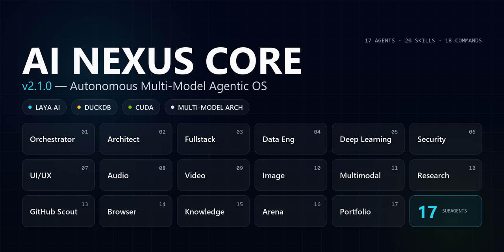
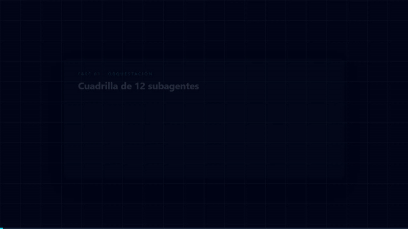
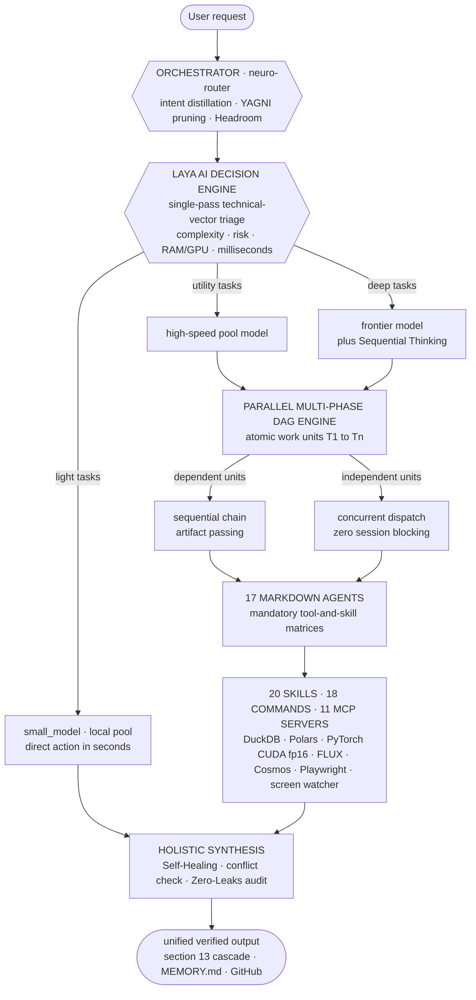

<div align="center">

# AI Nexus Core v2.1.0 — Autonomous Multi-Model Agentic OS

[](CHANGELOG.md)
[](#laya-ai-decision-engine)
[](#parallel-multi-phase-dag-engine)
[](#the-17-agent-squad)
[](#whats-new-in-v210)
[](https://duckdb.org/)
[](https://pola.rs/)
[](https://developer.nvidia.com/cuda-toolkit)
[](#guarantees)
[](https://opencode.ai/)
[](https://playwright.dev/)

<p align="center">
  
</p>

**An autonomous, self-improving, multi-model agentic operating system: 17 Markdown agents, a probabilistic decision engine (Laya), parallel DAG concurrency, non-destructive local RAG, GPU acceleration, and browser-use agentic navigation.**



**▶ Try the live interactive artifact: [`opus_neural_interactive.html`](assets/opus_neural_interactive.html)** — a 45-node particle-physics neural network with magnetic cursor gravity, click-triggered shockwaves, a glassmorphic telemetry panel and three GPU-composited render modes: *Quantum Physics*, *Neural Network*, *Data Mesh*.

*Motion showcase — [HTML scene](assets/motion_showcase.html) · [raw WebM](assets/video/showcase_ai_nexus_core.webm)*

</div>

---

## What it is

An agentic operating system built entirely from **Markdown documents** — no `class Agent`, no CrewAI, no LangChain, zero framework lock-in. The orchestrator distills every request, the **Laya AI** engine triages it by technical vector in a single probabilistic pass, the **Parallel Multi-Phase DAG Engine** decomposes it into atomic work units with per-phase resource packages, and the **§13 propagation protocol** keeps every file of the repository in coherence. Local-first by constitution: a **$0 inference floor** with Ollama + CUDA on a GTX 1050 Ti, and cloud frontier models when the task demands them — the user decides every escalation.

## Verified operating metrics

| **$0** | **60 FPS** | **< 500 MB** | **17** | **−85 %** |
|:---:|:---:|:---:|:---:|:---:|
| inference cost floor — local Ollama fallback, always available | GPU-composited canvas, validated E2E (headless Chromium) | streaming DuckDB/Polars RAM ceiling — `SET memory_limit` enforced | Markdown agents · 20 skills · 18 commands · **0 frameworks** | tokens per browser interaction — DOM-pruned `observe` / `act` / `extract` navigation (browser-use methodology) |

## What's new in v2.1.0

| Feature | What it does |
|---|---|
| **Browser-Use Agentic Navigation** | `automation-browser` + `playwright-testing` navigate with DOM pruning — accessibility-tree snapshots, numbered interactive elements, and the `observe()` / `act(indice, accion)` / `extract(esquema)` primitives — cutting token consumption per interaction by ~85%. Laya supervision blocks destructive clicks and private-data extraction. |
| **Screen Awareness** | `scripts/screen_watcher.py` takes lightweight, ephemeral screen or active-window snapshots (`assets/temp_screen.png` — ephemeral, git-locked) for real-time interface audits by vision models (Nemotron 3.5 Super VL). |
| **Social Preview (Open Graph)** | Official 1280×640 banner [`assets/social_preview.png`](assets/social_preview.png): wordmark, the 17-agent grid in glass cards, and Laya AI · DuckDB · CUDA · Multi-Model chips. Programmatic PIL render, razor-sharp text. |
| **Latency Pruning** | The Master Constitution lived 3× in session-injected files. Now canonicalized in `AGENTS.md` §14 with pointer-only mirrors — ~2/3 of the normative boot cost recovered on every session. |
| **find-skills sweep** | Integrated with attribution: `vercel-labs/agent-browser` (1.1M installs), `web-design-guidelines` (762K), `hyperframes-animation` (980K), `vercel-react-view-transitions` (161K), `transitions.dev`, `app-store-screenshots` (52K), and context-compression connectors. |

<details>
<summary><b>v2.0.0 core capabilities (deep dive)</b></summary>

| Capability | What it does |
|---|---|
| **Laya AI Decision Engine** | Single-pass probabilistic triage by technical vector — complexity, risk, dependencies, RAM/GPU cost. No rigid rules. Optimal model selected autonomously from the live pool in `opencode.json`. |
| **Parallel Multi-Phase DAG Engine** | Multi-point requests become atomic work units (T1…Tn). Dependents chain sequentially passing artifacts; independents fire concurrently without blocking the session. |
| **Dynamic Per-Phase Resource Matrix** | Each phase scored 1-10 with an exclusive package (model + agent + skills + MCPs). Below 4: direct action on a light model. Seven or higher: specialist subagent with deep reasoning + Sequential Thinking. |
| **Recursive Self-Improvement (§13)** | Every tool, script, connector or model propagates through six repository levels. The Coherence Gate bans orphan tools and stale assumptions. |
| **Autonomous Model Ingestion & Pruning** | Docs dropped in `data/inbox/` are assimilated into `opencode.json` and propagated; deprecated/404 models are pruned. Zero burned models across all 17 agents. |
| **Multimodal GPU Suite** | FLUX 3 Klein image generation (`scripts/nvidia_flux.py` → `output/images/`) and NVIDIA Cosmos video simulation (`scripts/nvidia_cosmos.py` → `output/videos/`), sealed in skills and agent matrices. |

**Certified live benchmark:** full traceability of a concurrent heterogeneous dispatch in [`output/trazabilidad_orquestacion_completa.md`](output/trazabilidad_orquestacion_completa.md).

</details>

## Laya AI Decision Engine

- Rigid classification is **prohibited**: every message is triaged by its technical vector (algorithmic complexity, risk, dependencies, RAM/GPU cost, irreversibility) in one probabilistic pass measured in milliseconds.
- **Autonomous model-pool selection**: `opencode.json` is the single source of truth — light tasks route to the fast/local pool (`small_model`), deep work to the strongest frontier model connected (`model`), and media generation is delegated to **executor scripts**, never to an LLM.
- **Anti-sycophancy by constitution**: inefficient structures, deprecated libraries and fragile architectures are flagged with evidence and a superior alternative — the final decision is always the user's.

## Parallel Multi-Phase DAG Engine

Multi-point requests are **acyclic graphs of atomic work units**, never linear queues. Units with data dependencies chain sequentially passing artifacts; independent units run **concurrently, immediately**, never blocking the session. Each phase wakes only the subagents, skills and MCP servers it needs (atomic tool isolation). Light secondary tasks from the same prompt run in the background while heavy pipelines continue, and the orchestrator consolidates every output through the Self-Healing protocol before delivering one clean, unified response.

## System Architecture



## The 17-Agent Squad

Every agent is a single Markdown file with a mandatory tool matrix: an agent can only use what its matrix declares. Four pillars of the grid:

- **`orchestrator`** — the neuro-router: distillation, Laya triage, DAG dispatch, §13 cascade.
- **`software-architect`** — clean architecture, SOLID, the YAGNI ladder.
- **`automation-browser`** — the browser-use agent: `observe` / `act` / `extract` with DOM pruning, plus screen awareness for vision-model audits.
- **`ai-multimodal-engineer`** — frontier generative AI and multimodal RAG.

<details>
<summary><b>Full 17-agent grid</b></summary>

| Agent | Domain | Role |
|---|---|---|
| `orchestrator` | Governance | Master router: intent distillation, Laya triage, DAG dispatch, §13 cascade, `/arena` convener |
| `software-architect` | Architecture | Clean architecture, SOLID, minimalist design via the YAGNI ladder |
| `fullstack-developer` | Web | Next.js, React, TypeScript, Tailwind, FastAPI/Node, SQLite/PostgreSQL/DuckDB |
| `portfolio-git` | Git | Semantic commits in Spanish, GitHub portfolio synchronization |
| `code-reviewer-security` | Security | OWASP Top 10, static analysis, credential-leak detection, release gate |
| `auto-researcher` | Research | Model ingestion from `data/inbox/`, 404 pruning, official-docs validation, benchmarks radar |
| `github-scout` | Trends | Viral AI repos, new model releases, deprecation alerts, Windows Toast notifications |
| `data-engineer` | Data | DuckDB + Polars OLAP streaming pipelines under a strict 500 MB RAM ceiling |
| `ml-deeplearning-specialist` | ML | PyTorch, CUDA fp16 on 4 GB VRAM, local embeddings, quantization, Hugging Face MCP |
| `ui-ux-director` | Design | Anti-slop tokens, typography scale, spring-physics micro-animations |
| `image-generative-designer` | Image | Art direction, prompt engineering, FLUX generation via `scripts/nvidia_flux.py` |
| `audio-sound-engineer` | Audio | Web Audio API, TTS, Whisper, spectral analysis, micro-tactile sound design |
| `video-media-engineer` | Video | Playwright capture, Cosmos generation via `scripts/nvidia_cosmos.py`, MoviePy/FFmpeg, 60 FPS |
| `ai-multimodal-engineer` | GenAI | Frontier generative AI, multimodal RAG (text + image + audio), agentic flows |
| `automation-browser` | Browser | Browser-use agentic navigation (`observe`/`act`/`extract`), Playwright E2E, Crawl4AI, n8n, screen awareness |
| `knowledge-graph-agent` | Memory | LightRAG, Claude-Mem, Graphify, Obsidian graph, `MEMORY.md` curation, visual context ingestion |
| `arena-arbiter` | Governance | Arena tournament judge: cross-critique moderation, rubric scoring, final verdict |

</details>

## Quickstart

```bash
git clone https://github.com/AFelipeRD/AI_Nexus_Core.git && cd AI_Nexus_Core
python -m venv .venv && .venv\Scripts\activate
pip install -r requirements.txt && playwright install chromium
```

Create a `.env` file in the root (**git-ignored — never commit it**) with your own tokens: `GITHUB_PERSONAL_ACCESS_TOKEN=<your-github-token>` · `NVIDIA_API_KEY=<your-nvidia-key>` (read at runtime from `.secrets/nvidia.key` by the generation scripts) · `HF_TOKEN=<your-hf-token>` (optional).

```bash
ollama pull qwen2.5-coder:7b
npm install -g opencode-ai && opencode
```

First run: `/sync-catalog`. Then just talk — the orchestrator distills, decomposes into a DAG and routes. Precision shortcuts: `/think` · `/arena` · `/yagni` · `/craft` · `/analyze-data` · `/browser-test` · `/security-audit` · `/commit` · `/evolve`.

## Guarantees

- **Zero-Leaks, by constitution**: `.env`, `.secrets/`, `opencode.json` and screen captures (`assets/temp_screen*.png`) are git-locked; pre-push secret scanning on every release; OWASP-aware review gate before any merge.
- **YAGNI as law**: nothing is built before the ladder says so — and `find-skills` is consulted before creating any capability that might already exist.
- **Recursive self-improvement (§13)**: every new tool, script, connector or model propagates through the six repository levels; the **Coherence Gate** rejects deliveries with orphan tools, stale assumptions or deprecated parameters.

## Reference

<details>
<summary><b>Skills (20) · Commands (18) · MCP servers (11 · 5 active)</b></summary>

**Skills by suite** — Gobernanza: `find-skills` · `ponytail-yagni` · `arena-consensus` · `sequential-thinking` · `headroom-context` · `ecosystem-evolution` · Datos: `duckdb-analytics` · `graphify-codebase` · `lightrag-knowledge` · ML: `neural-network-ml` · `auto-research` · Diseño: `ui-ux-design-suite` · `image-creative-suite` · Web y media: `fullstack-architecture` · `playwright-testing` (browser-use) · `video-processing-suite` · `audio-sound-suite` · `ai-multimodal-ops` · Utilidades: `git-portfolio-sync` · `windows-notifier`.

**Commands (18)**: `/think` · `/arena` · `/yagni` · `/headroom` · `/analyze-data` · `/train-model` · `/craft` · `/critique` · `/taste` · `/animate` · `/browser-test` · `/research` · `/scout` · `/security-audit` · `/commit` · `/graphify` · `/evolve` · `/sync-catalog`.

**MCP servers** — Active (5): `github`, `filesystem`, `playwright`, `claude-mem`, `sequential-thinking`. Dormant (6): `n8n`, `figma`, `mem0`, `huggingface`, `context7` (up-to-date docs for LLMs), `magic-21st` (UI component generation — requires `MAGIC_API_KEY`). Dormant servers are activated by editing `opencode.json` (local, git-ignored) — never by touching agent code.

</details>

<details>
<summary><b>Architectural pillars deep dive</b></summary>

- **Model-Agnostic Hybrid Compute**: no agent is bound to a provider; all 17 inherit dynamically from the active global model in `opencode.json` (live pool: NVIDIA Build NIM — GLM 5.3, Nemotron 3.5 Super VL, DeepSeek v4.1 Flash — plus Ollama local at $0 per inference). Rotating a provider is configuration, never code.
- **100% Markdown-Native Agents**: plain `.md` files implementing the Linux Foundation `AGENTS.md` standard and the Anthropic Agent Skills specification — readable, versionable, portable, auditable.
- **Arena Consensus (LLM Council)**: critical decisions enter a tournament — parallel variants, cross-critique, impartial rubric scoring (simplicity, speed, security, robustness); a security score ≤ 2 disqualifies outright.
- **High-Speed OLAP Core & Non-Destructive RAG**: DuckDB + Polars streaming under a strict 500 MB ceiling; `data/raw/` and `data/inbox/` are strictly read-only, indexes and outputs only in `data/processed/` or `output/`.
- **Anti-Slop Motion Engine**: deep OLED palettes, real glassmorphism, spring physics under 250 ms, GPU-composited canvas at stable 60 FPS — validated with Playwright E2E.
- **Knowledge Graph & Obsidian Vault**: the repository doubles as an Obsidian vault — decisions, entities and session logs persist as interlinked Markdown indexed by LightRAG and Claude-Mem, with structural code mapping by Graphify.
- **Browser-Use Navigation & Screen Awareness**: accessibility-tree-first agent navigation with `observe`/`act`/`extract` primitives, plus `scripts/screen_watcher.py` for ephemeral vision-model snapshots — both under Laya supervision against destructive actions and private data.

</details>

<details>
<summary><b>Security policy (Zero-Leaks) deep dive</b></summary>

- Secrets never enter the repo: `.gitignore` locks `.env`, `*.env`, `*.key`, `*.pem`, `.secrets/`, `opencode.json` and `assets/temp_screen*.png`; no agent may alter it to include sensitive files.
- Tokens never travel in URLs: pushes use the OS credential manager; API calls read tokens from environment variables; generation scripts read `.secrets/nvidia.key` at runtime only.
- Pre-push secret scanning on every release (token patterns and private key blocks).
- OWASP-aware review gate: `code-reviewer-security` audits static analysis, input validation and credential leaks before any merge.
- Validated dependencies: `auto-researcher` verifies maintenance, licensing and vulnerabilities before adoption.

</details>

<details>
<summary><b>Docs & traceability index</b></summary>

| Manual | Content |
|---|---|
| [`docs/01`](docs/01_MANUAL_ECOSISTEMA_OPENCODE.md) | OpenCode ecosystem manual |
| [`docs/02`](docs/02_REDES_NEURONALES_Y_DEEP_LEARNING.md) | Neural networks & deep learning (PyTorch, Hugging Face) |
| [`docs/03`](docs/03_SUITE_DISENO_MOTION_Y_PLAYWRIGHT.md) | Design, motion & Playwright |
| [`docs/04`](docs/04_INGENIERIA_DATOS_Y_GRAPHIFY.md) | Data engineering & Graphify |
| [`docs/05`](docs/05_GRAFO_LIGHTRAG_Y_OBSIDIAN.md) | LightRAG graph & Obsidian |
| [`docs/06`](docs/06_PROTOCOLO_ARENA_Y_CONSENSO.md) | Arena consensus protocol |
| [`docs/07`](docs/07_MANUAL_OPERATIVO.md) | Full operating manual |
| [`output/trazabilidad_orquestacion_completa.md`](output/trazabilidad_orquestacion_completa.md) | Certified live concurrency traceability benchmark |

Full version history in [`CHANGELOG.md`](CHANGELOG.md).

</details>

## Attribution & community skills

Community skills integrated with attribution (validated via `find-skills`): Anthropic (`frontend-design`, `webapp-testing`, `canvas-design`) · Vercel Labs (`agent-browser`, `web-design-guidelines`, `vercel-react-view-transitions`) · HeyGen (`hyperframes-animation`) · Paul Bakaus (`impeccable`) · Emil Kowalski (`animate-expo`, `animation-vocabulary`) · LangChain (RAG) · Currents (Playwright best practices) · `transitions.dev` · `app-store-screenshots` · taste-skill · context-compression connectors.

## License & Author

Released under the **[MIT License](LICENSE)**.

**AFelipeRD** — AI Engineer · [GitHub](https://github.com/AFelipeRD) · [afrsenju@outlook.com](mailto:afrsenju@outlook.com)

> Built on Windows 11 with a rotating multi-model pool, a probabilistic decision engine, and a firm belief that agents should be documents — not frameworks.
