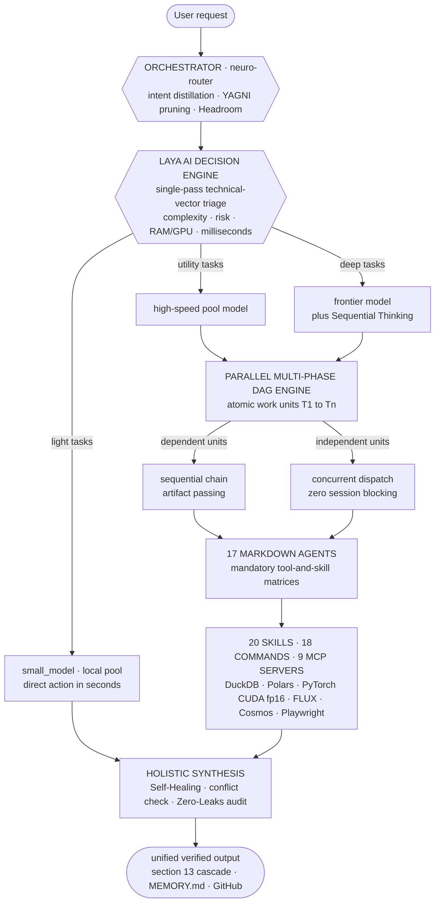

<div align="center">

# AI Nexus Core v2.0.0 — Autonomous Multi-Model Agentic OS

**An autonomous, self-improving, multi-model agentic operating system: Laya probabilistic decision engine, parallel DAG concurrency, non-destructive local RAG, holistic tool propagation, and GPU acceleration — built entirely from Markdown agents.**

[](CHANGELOG.md)
[](#laya-ai-decision-engine)
[](#parallel-multi-phase-dag-engine)
[](#the-17-agent-squad)
[](https://duckdb.org/)
[](https://pola.rs/)
[](https://developer.nvidia.com/cuda-toolkit)
[](#zero-leaks-security-policy)
[](https://opencode.ai/)
[](https://playwright.dev/)


**▶ Try the live interactive artifact: [`opus_neural_interactive.html`](assets/opus_neural_interactive.html)** — a 45-node particle-physics neural network with magnetic cursor gravity, click-triggered shockwaves, a glassmorphic telemetry panel (live 60 FPS monitor, DuckDB + Polars streaming widget, GTX 1050 Ti status) and three GPU-composited render modes: *Quantum Physics*, *Neural Network*, *Data Mesh*.

*Above: the motion showcase — [HTML scene](assets/motion_showcase.html) · [raw WebM](assets/video/showcase_ai_nexus_core.webm)*

</div>

---

## What's New in v2.0.0

| Capability | What it does |
|---|---|
| **Laya AI Decision Engine** | Every request is triaged in a single probabilistic pass by its technical vector — algorithmic complexity, risk, dependencies, RAM/GPU cost — in milliseconds. No rigid rules. The optimal model is selected autonomously from the live pool in `opencode.json`. |
| **Parallel Multi-Phase DAG Engine** | Multi-point requests decompose into atomic work units (T1…Tn). Dependent units chain sequentially passing artifacts; independent units run **concurrently**, never blocking the session. |
| **Dynamic Per-Phase Resource Matrix** | Each phase is scored (1-10) and gets an exclusive execution package — model + agent + skills + MCPs. Below 4: direct action on a light model. Seven or higher: specialist subagent with deep reasoning and Sequential Thinking. Atomic tool isolation per phase. |
| **Recursive Self-Improvement Protocol (§13)** | Every new tool, script, connector or model propagates through all six repository levels — script → `SKILL.md` → agent matrices → central catalog → `MEMORY.md` → `docs/`. Orphan tools and stale assumptions are constitutionally banned by the Repository Coherence Gate. |
| **Autonomous Model Ingestion & Pruning** | Documentation dropped in `data/inbox/` is assimilated, updates `opencode.json` and propagates to skills; deprecated or 404 models are pruned from the active pool. Zero burned models across all 17 agents — full provider rotation freedom. |
| **Multimodal GPU Suite** | FLUX 3 Klein image generation (`scripts/nvidia_flux.py` → `output/images/`) and NVIDIA Cosmos video simulation (`scripts/nvidia_cosmos.py` → `output/videos/`), documented in skills and sealed in the specialists' tool matrices. |

**Certified live benchmark:** the full traceability of a concurrent heterogeneous dispatch — DuckDB streaming, architecture audit and a multimodal brief-to-timeline chain — is published in [`output/trazabilidad_orquestacion_completa.md`](output/trazabilidad_orquestacion_completa.md).

---

## Laya AI Decision Engine

> Rigid classification is prohibited. Laya evaluates the **technical vector** of every message — algorithmic complexity, risk, dependencies, RAM/GPU consumption, irreversibility, retry cost — in a **single probabilistic pass measured in milliseconds**.

- **Autonomous model-pool selection:** `opencode.json` is the single source of truth. Light tasks, utilities and terminal operations route to the high-speed/local pool (`small_model`); architecture, deep logic, Arena arbitration and security-critical work route to the most powerful frontier model connected (`model`); media generation (image, video, audio) is delegated to **executor scripts**, never to an LLM.
- **Anti-sycophancy by constitution:** inefficient structures, deprecated libraries, RAM-hungry code and fragile architectures are flagged with technical evidence and a superior alternative — the final decision always belongs to the user.
- **Deliberation is matricial, not narrative:** internal reasoning happens as a decision matrix; prose only appears in the final answer.

## Parallel Multi-Phase DAG Engine

Every multi-point request is a **directed acyclic graph of atomic work units**, never a linear queue:

1. **Cognitive decomposition** — messages with phases, lists or multiple asks are segmented immediately into atomic units T1…Tn, each with a goal, an expected artifact and a termination criterion.
2. **Dependency analysis** — if Tn depends on Tn-1, execution chains sequentially passing the artifact; if Tn is independent, it **fires concurrently right away** without making the user wait.
3. **Per-phase resource matrix** — each phase is scored 1-10 and wakes only the subagents, skills and MCP servers it needs (atomic tool isolation; unrelated tools are banned from a phase's context).
4. **Parallel dispatch** — a heavy pipeline (data, ML training) coexists with light secondary tasks from the same prompt (formatting, image generation, quick lookups): the light ones run in the background on the fast executor **while the heavy flow continues**.
5. **Holistic synthesis** — the orchestrator collects every phase's output, checks for conflicts and syntax errors via the Self-Healing protocol, and delivers one clean, unified response.

---

## System Architecture



## The 17-Agent Squad

Every agent is a single Markdown file with a mandatory tool matrix: an agent can only use what its matrix declares.

| Agent | Domain | Role |
|---|---|---|
| `orchestrator` | Governance | Master router: intent distillation, Laya triage, DAG dispatch, §13 cascade, `/arena` convener |
| `software-architect` | Architecture | Clean architecture, SOLID, minimalist design via the YAGNI ladder |
| `fullstack-developer` | Web | Next.js, React, TypeScript, Tailwind, FastAPI/Node, SQLite/PostgreSQL/DuckDB |
| `portfolio-git` | Git | Semantic commits in Spanish, GitHub portfolio synchronization |
| `code-reviewer-security` | Security | OWASP Top 10, static analysis, credential-leak detection, release gate |
| `auto-researcher` | Research | Model ingestion from `data/inbox/`, 404 pruning, official-docs validation, benchmarks radar |
| `github-scout` | Trends | Viral AI repos, new model releases, deprecation alerts, Windows Toast notifications |
| `data-engineer` | Data | DuckDB + Polars OLAP streaming pipelines under a strict 500 MB RAM ceiling |
| `ml-deeplearning-specialist` | ML | PyTorch, CUDA fp16 on 4 GB VRAM, local embeddings, quantization, Hugging Face MCP |
| `ui-ux-director` | Design | Anti-slop tokens, typography scale, spring-physics micro-animations |
| `image-generative-designer` | Image | Art direction, prompt engineering, FLUX generation via `scripts/nvidia_flux.py` |
| `audio-sound-engineer` | Audio | Web Audio API, TTS, Whisper, spectral analysis, micro-tactile sound design |
| `video-media-engineer` | Video | Playwright capture, Cosmos generation via `scripts/nvidia_cosmos.py`, MoviePy/FFmpeg, 60 FPS |
| `ai-multimodal-engineer` | GenAI | Frontier generative AI, multimodal RAG (text + image + audio), agentic flows |
| `automation-browser` | Browser | Playwright E2E, Crawl4AI scraping, n8n workflows |
| `knowledge-graph-agent` | Memory | LightRAG, Claude-Mem, Graphify, Obsidian graph, `MEMORY.md` curation |
| `arena-arbiter` | Governance | Arena tournament judge: cross-critique moderation, rubric scoring, final verdict |

## Core Architectural Pillars

### Model-Agnostic Hybrid Compute
No agent is bound to a provider: all 17 inherit dynamically from the active global model in `opencode.json` (live pool: NVIDIA Build NIM — GLM 5.3, Nemotron 3.5 Super VL, DeepSeek v4.1 Flash — plus Ollama local at **$0 per inference**). Rotating a provider is configuration, never code. GPU work runs on a GTX 1050 Ti with **CUDA, fp16 mixed precision and explicit VRAM cache management** inside 4 GB.

### 100% Markdown-Native Agents
Agents are not code. They are plain `.md` files implementing the **Linux Foundation `AGENTS.md` standard** and the **Anthropic Agent Skills specification** — zero `class Agent`, zero CrewAI, zero LangChain. Readable, versionable, portable, auditable.

### Recursive Self-Improvement (§13)
The constitution mandates a **Holistic Impact Mapping** on every evolution: a change propagates through six levels (script → skill manual → agent matrices → central catalog → dated memory record → architecture docs). The **Coherence Gate** rejects any delivery that leaves orphan tools, stale assumptions or deprecated parameters behind.

### Arena Consensus (LLM Council)
Critical decisions — architecture, security, destructive operations, ML design — enter a **tournament protocol**: subagents generate candidate variants, cross-critique each other's flaws, and an impartial arbiter scores them on a four-axis rubric (simplicity, speed, security, robustness). A security score of 2 or less disqualifies a variant outright. Verdicts are persisted to long-term memory.

### High-Speed OLAP Data Core & Non-Destructive RAG
**DuckDB + Polars** process CSV, Parquet and JSON in streaming fashion under a **strict 500 MB RAM ceiling**. Local RAG is non-destructive by constitution: `data/raw/` and `data/inbox/` are strictly read-only; indexes and outputs live only in `data/processed/` or `output/`.

### Anti-Slop Motion Engine (Opus Level)
Interfaces are governed by an engineering-grade design system: deep OLED palettes, radial gradient meshes, real glassmorphism, spring physics under 250 ms, GPU-composited canvas layers at stable 60 FPS — all validated with **Playwright E2E** in a real browser.

### Knowledge Graph & Obsidian Vault
The repository doubles as an **Obsidian vault**: decisions, entities and session logs persist as interlinked Markdown (`[[wikilinks]]`) and are indexed into an entity-relation + vector knowledge graph via **LightRAG** and **Claude-Mem**, with structural code mapping by **Graphify**.

---

## Quickstart

### 1 · Clone and set up the environment

```bash
git clone https://github.com/AFelipeRD/AI_Nexus_Core.git
cd AI_Nexus_Core

python -m venv .venv
.venv\Scripts\activate        # Windows
# source .venv/bin/activate   # Linux / macOS

pip install -r requirements.txt
playwright install chromium   # E2E testing & video recording
```

> **GPU note (Windows):** for CUDA-enabled PyTorch, install it *before* the requirements:
> `pip install torch torchvision --index-url https://download.pytorch.org/whl/cu124`

### 2 · Configure environment variables

Create a `.env` file in the repository root (it is **git-ignored — never commit it**):

```bash
# .env — fill with your own values, never real tokens in docs or code
GITHUB_PERSONAL_ACCESS_TOKEN=<your-github-token>
GITHUB_USERNAME=<your-github-username>
NVIDIA_API_KEY=<your-nvidia-key>        # optional cloud generation (read from .secrets/nvidia.key)
HF_TOKEN=<your-hf-token>                # optional, ML agent
OLLAMA_BASE_URL=http://127.0.0.1:11434/v1
```

### 3 · Pull the local model and run OpenCode

```bash
ollama pull qwen2.5-coder:7b

npm install -g opencode-ai    # or: curl -fsSL https://opencode.ai/install | bash
opencode                      # agents, skills and commands are discovered automatically
```

First run: execute `/sync-catalog` to regenerate the agent/skill/command catalogs.

### 4 · Drive the squad

Talk normally — the orchestrator distills, decomposes into a DAG and routes. Precision shortcuts: `/think` · `/arena` · `/yagni` · `/headroom` · `/craft` · `/analyze-data` · `/train-model` · `/browser-test` · `/security-audit` · `/commit` · `/evolve` — see [`.opencode/commands/`](.opencode/commands/README.md) for all 18.

---

## Operating Constraints & Benchmarks

Honest engineering targets — enforced by the project constitution and validated where measurable:

| Metric | Target | Status |
|---|---|---|
| Inference cost floor | **$0.00** — local fallback (Ollama + CUDA) always available | Enforced by architecture |
| Motion performance | **60 FPS** on GPU-composited canvas | Validated E2E (Playwright, headless Chromium) |
| Data pipeline RAM ceiling | **< 500 MB** streaming in-memory (`SET memory_limit` enforced) | Constitution-enforced constraint |
| GPU VRAM budget | **4 GB** — fp16 mixed precision + explicit cache flush | Constitution-enforced constraint |
| Agent framework dependencies | **0** — 17 plain `.md` agents, 20 skills, 18 commands, 9 MCP servers | By design (Linux Foundation `AGENTS.md`) |
| Burned-in models | **0** — dynamic inheritance across all 17 agents | Verified: zero `model:` anchors in agent frontmatter |
| Credential leaks | **0** | Pre-push secret scan on every release |

---

## Zero-Leaks Security Policy

- **Secrets never enter the repo** — `.gitignore` locks `.env`, `*.env`, `*.key`, `*.pem`, `.secrets/` and `opencode.json`; no agent may alter it to include sensitive files.
- **Tokens never travel in URLs** — pushes use the OS credential manager; API calls read `GITHUB_TOKEN` / `GITHUB_PERSONAL_ACCESS_TOKEN` from environment variables; generation scripts read `.secrets/nvidia.key` at runtime only.
- **Pre-push secret scanning** — every release diff is scanned for token patterns and private key blocks before it leaves the workstation.
- **OWASP-aware review gate** — `code-reviewer-security` audits static analysis, input validation and credential-leak detection before any merge.
- **Validated dependencies** — `auto-researcher` verifies maintenance status, licensing and known vulnerabilities before any dependency is adopted.

---

## License & Author

Released under the **[MIT License](LICENSE)**.

**AFelipeRD** — AI Engineer · [GitHub](https://github.com/AFelipeRD) · [afrsenju@outlook.com](mailto:afrsenju@outlook.com)

> Built on Windows 11 with a rotating multi-model pool, a probabilistic decision engine, and a firm belief that agents should be documents — not frameworks.
